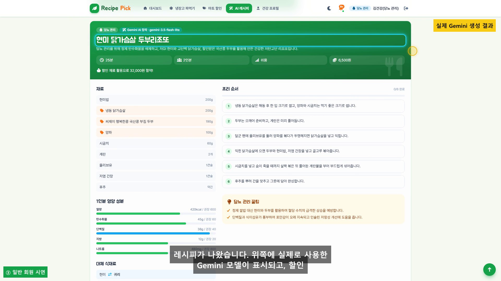

# RecipePick

AI 레시피 및 식단 추천: 냉장고 파먹기 컨셉. RPA로 대형마트 할인가 식재료를 찾고, AI가 그 재료들로 사용자 건강 상태(당뇨, 다이어트 등)에 맞는 레시피를 창작해줍니다.

| 구분 | URL |
| :--- | :--- |
| GitHub | https://github.com/fsclass-n/recipepick |
| 프로젝트 안내 (GitHub Pages) | https://fsclass-n.github.io/recipepick/ |
| Frontend Staging (Netlify) | https://recipepick.netlify.app |
| Frontend Production (Render) | https://recipepick.onrender.com |
| Backend API (Render) | https://recipepick-api.onrender.com (`/docs`) |

## 발표·시연 영상 (10분)

[](https://github.com/fsclass-n/recipepick/releases/latest/download/recipepick_final.mp4)

> 팀 구성 (1인 프로젝트): 홍기흥 (Full-stack Developer) · 실제 운영 사이트에서 일반 회원과 관리자 계정을 비교 시연 · 내레이션은 AI 합성 음성입니다.

| 시간 | 내용 |
| :--- | :--- |
| 00:00 | PPT 발표 — 문제 정의 · 아키텍처 · 기술 선택 · RPA · Gemini · DevOps · 트러블슈팅 |
| 03:00 | 운영 서비스 — 메인페이지 · 오늘의 할인 |
| 03:30 | 일반 회원 — 대시보드 · 냉장고 하이라이트 · 장바구니 맵 · 마트 할인 · AI 레시피 생성 · 관리자 화면 차단(403) |
| 06:30 | 관리자 — 크롤러 모니터링 · Plotly 차트 · 작업 로그 · **두 계정 좌우 비교(실시간 반영·자기 권한 잠금)** · API 문서 · CI |
| 09:00 | 클로징 — 회고 · 다음 단계 · QR |

대본·연출 가이드: [`docs/video/영상_대본_및_연출가이드.md`](docs/video/영상_대본_및_연출가이드.md) · 자막: [`docs/video/recipepick_final.srt`](docs/video/recipepick_final.srt)

## 디렉터리 구조

```text
recipepick/
├── backend/            # FastAPI 앱 (app/), Dockerfile, pytest (tests/)
│   └── app/
│       ├── routers/    # auth(OAuth 포함) · fridge · deals · recipes · notifications · admin · ws
│       └── services/   # gemini(레시피 창작) · crawler(스케줄러) · matcher(할인 매칭) · notifier(WebSocket/웹훅)
├── rpa/                # Playwright + BeautifulSoup 마트 크롤러 (python -m rpa)
├── frontend/           # React 19 + Vite + Tailwind CSS v4
├── pages/              # GitHub Pages 프로젝트 안내 페이지
├── docs/               # 산출물 · 진행일지
├── .github/workflows/  # ci · deploy · pages
├── docker-compose.yml  # 로컬 통합 실행
├── render.yaml         # Render Blueprint (API + Static Site)
├── netlify.toml        # Netlify 빌드 설정
├── requirements.txt
└── .env.example        # 환경 변수 템플릿 (Render 필수 변수 [R] 표기)
```

## 로컬 실행

```bash
# 0) 환경 변수
cp .env.example .env            # SECRET_KEY, GEMINI_API_KEY, TiDB 정보 입력 (TIDB_HOST 비우면 SQLite)

# 1) 백엔드 (Python 3.11)
py -3.11 -m venv .venv
.venv/Scripts/pip install -r requirements.txt     # macOS/Linux: .venv/bin/pip
.venv/Scripts/python -m playwright install chromium
cd backend && ../.venv/Scripts/python -m uvicorn app.main:app --reload --port 8000

# 2) 프런트엔드 (Node 22+)
cd frontend && npm install && npm run dev          # http://localhost:5173

# 또는 Docker
docker compose up --build
```

### 테스트 계정 (`SEED_TEST_ACCOUNTS=true`)

| 구분 | 이메일 | 비밀번호 |
| :--- | :--- | :--- |
| 일반 회원 (당뇨 관리 프로필) | user@recipepick.dev | Recipe!2026 |
| 시스템 관리자 | admin@recipepick.dev | Admin!2026 |

## 테스트 / 빌드

```bash
cd backend && ../.venv/Scripts/python -m pytest -q   # API · 크롤링→매칭→알림 · WebSocket · RPA 파서
cd frontend && npm run build
python -m rpa --mode auto                             # 크롤러 단독 실행 (--json 으로 결과 출력)
```

## RPA 수집 정책

| 마트 | 기본 동작 | 사유 |
| :--- | :--- | :--- |
| 홈플러스 | **라이브 수집** (Playwright, 검증된 셀렉터) | robots.txt 허용 경로 |
| 롯데마트 (롯데ON) | 데모 데이터 | robots.txt 가 일반 크롤러 `Disallow: /` |
| 이마트 (SSG.COM) | 데모 데이터 | Akamai 봇 차단 |

- 크롤러는 요청 전 robots.txt 를 확인하고 요청 간 지연(crawl_delay)을 둡니다.
- 검색 키워드는 사용자 장바구니 품목(빈도순) + `RPA_KEYWORDS` + 기본 키워드로 구성됩니다.
- `RPA_MODE=auto` 는 라이브 실패/0건 시 데모로 대체하며, 데모 상품은 UI 에 `DEMO` 배지로 표시됩니다.
- 공식 API·제휴 확보 시 각 크롤러의 `live_enabled = True` 로 전환합니다.

## 배포 (main 푸시 → 자동 배포)

별도 Deploy Hook / 토큰 없이 각 플랫폼의 GitHub 연동으로 자동 배포됩니다.

| 대상 | 방식 |
| :--- | :--- |
| Render API (`recipepick-api`) | Render Git 연동 · `autoDeployTrigger: commit` (Docker, Playwright Chromium 포함) |
| Render 프런트 (`recipepick`) | Render Git 연동 · `autoDeployTrigger: commit` (Static Site) |
| Netlify (`recipepick.netlify.app`) | Netlify Git 연동 · `netlify.toml` (base=`frontend`) |
| GitHub Pages | `pages.yml` (pages/ 변경 시) — Settings › Pages › Source 를 **GitHub Actions** 로 설정 |

- `ci.yml` 은 pytest · 프런트 빌드 · Docker 빌드를 검증합니다(배포와 독립).
- Render 환경 변수 중 `sync: false` 항목(TiDB, GEMINI_API_KEY, OAuth 등)은 대시보드에서 입력합니다.
- **OAuth 콜백 URL**: `{BACKEND_URL}/api/auth/oauth/{google|naver|kakao}/callback`
