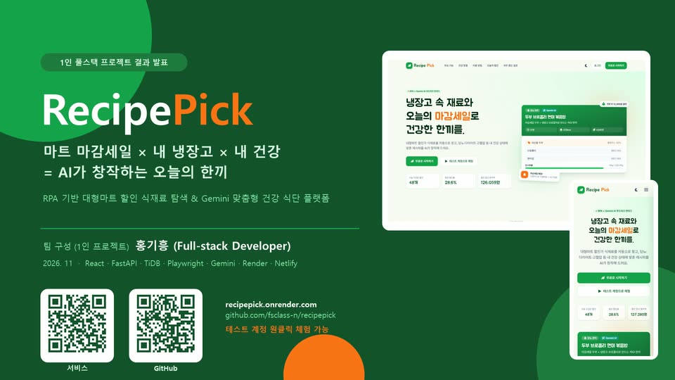

# 🥗 RecipePick

### 👉 포트폴리오 바로가기: **[https://fsclass-n.github.io/recipepick/](https://fsclass-n.github.io/recipepick/)**

**마트 마감세일 × 내 냉장고 × 내 건강 = AI가 창작하는 오늘의 한끼**

대형마트 할인 식재료를 RPA(Playwright)로 수집하고, 냉장고 재료와 건강 상태(당뇨·다이어트·고혈압 등)에 맞춰 Google Gemini가 레시피를 창작하는 푸드테크 플랫폼입니다.
팀 구성 (1인 프로젝트): **홍기흥 (Full-stack Developer)** — 기획 · 설계 · 개발 · 배포 · 발표 영상까지 직접 진행했습니다.

## 작품 및 프로젝트 소개

[포트폴리오 사이트](https://fsclass-n.github.io/recipepick/)에서 썸네일을 누르면 그 자리에서 바로 영상이 재생됩니다.

| 섹션 | 내용 |
| :--- | :--- |
| 🎬 영상 | 10분 발표·시연 영상(챕터 이동) · 60초 하이라이트 |
| 🎞 작품 | 장면별 9개 작품: 기술 발표 · 냉장고 할인 매칭 · Gemini 레시피 · 관리자 API 403 차단 · RPA 크롤러 모니터링 · 두 계정 실시간 비교 등 |
| 💡 프로젝트 | 기획 의도 · 5단계 제작 과정 · 핵심 기능 · 주요 성과 |
| 🧰 기술·문제 해결 | React · FastAPI · TiDB · Playwright · Gemini · Docker / 실제 트러블슈팅 3건 |

**서비스** [recipepick.onrender.com](https://recipepick.onrender.com) · **API 문서** [recipepick-api.onrender.com/docs](https://recipepick-api.onrender.com/docs) · **테스트 계정** `user@recipepick.dev` / `Recipe!2026` (관리자 `admin@recipepick.dev` / `Admin!2026`)

> 개발·배포 문서: [docs/개발_가이드.md](docs/개발_가이드.md) · 발표자료: [docs/프로젝트_발표자료.pptx](docs/프로젝트_발표자료.pptx)
